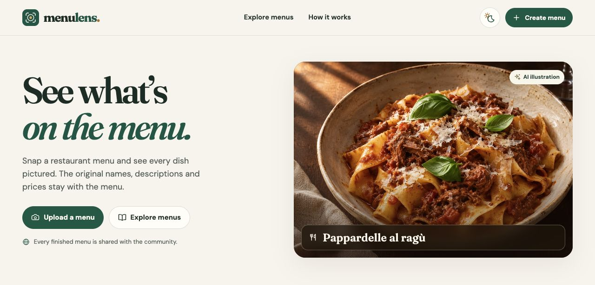

# Menu Lens

Turn a photo of a restaurant menu into a public, dated menu with an AI illustration for every dish. Diners review the original names, descriptions and printed prices before publishing. [Open Menu Lens](https://menu.9l.nz/)

[](https://menu.9l.nz/)

**Upload photos → confirm the restaurant → review the menu → publish**

You can close the tab after uploading. Return in the same browser within 24 hours to review the draft. Once approved, the finished menu appears at the same link. [Your submissions](https://menu.9l.nz/submissions)

| Choose a theme | Browse a published menu |
| :---: | :---: |
|  |  |

<details>
<summary><strong>Run, test and deploy</strong></summary>

Use Node.js 24 or newer. The homepage and public collection run without credentials.

```sh
node server.mjs   # http://127.0.0.1:8238
node --test
```

| Task | Configuration |
| --- | --- |
| Enable generation | Set `OPENAI_API_KEY`, `TURNSTILE_SITE_KEY`, `TURNSTILE_SECRET` and `TURNSTILE_HOSTNAME` in `.env`. Run `node --env-file=.env server.mjs`. |
| Configure AI | Open `/admin` to choose an image model, compare output costs and adjust image quality or menu-reading effort. The server reads `ADMIN_PIN_VERIFIER` from its private environment. |
| Runtime defaults | `OPENAI_IMAGE_MODEL`, `OPENAI_VISION_MODEL`, `DAILY_IMAGE_LIMIT` (120 by default). |
| Find restaurants | Set `NZ_RESTAURANT_INDEX` or `GOOGLE_PLACES_API_KEY`. GPS comparisons stay on the device. |
| Deploy to Oracle | Set `MENU_ORACLE_HOST` and optionally `MENU_ORACLE_IDENTITY`, then run `./deploy.sh`. Cloudflare Tunnel serves the site. SQLite persists in `menu-lens-data`. |

The New Zealand restaurant index uses OpenStreetMap data under the ODbL. Rebuild it with `tools/extract-nz-restaurants.py` and Python’s `osmium` package. [© OpenStreetMap contributors](https://www.openstreetmap.org/copyright)

</details>
