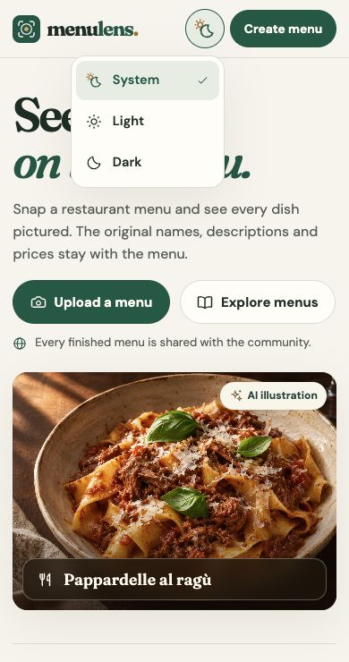
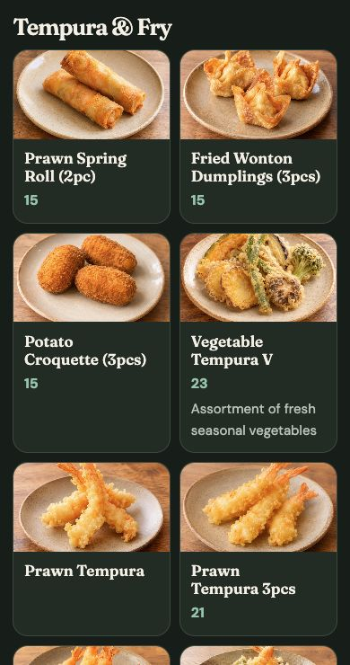

# Menu Lens

Turn a photo of a restaurant menu into a public, dated menu with an AI illustration for every dish. Menu Lens reads the original names, descriptions and printed prices, then illustrates and publishes the menu automatically. [Open Menu Lens](https://menu.9l.nz/)

[](https://menu.9l.nz/)

**Upload photos → choose the restaurant → generate and publish**

After uploading, copy the menu link before closing the tab. Open it in the same browser within 24 hours to follow progress or retry a failed read using the saved photos. Each read has up to five minutes. Menus with a photo for every dish stop after reading. Finished menus appear at the same link with the original photos in a collapsed section.

| Choose a theme | Browse a published menu |
| :---: | :---: |
|  |  |

<details>
<summary><strong>Run, test and deploy</strong></summary>

Use Node.js 24 or newer. The homepage and public collection run without credentials.

```sh
node server.mjs   # http://127.0.0.1:8238
node --test
```

| Task | Configuration |
| --- | --- |
| Enable generation | Set `OPENAI_API_KEY`, `TURNSTILE_SITE_KEY`, `TURNSTILE_SECRET` and `TURNSTILE_HOSTNAME` in `.env`. Run `node --env-file=.env server.mjs`. |
| Connect storage | Deploy `storage/wrangler.jsonc` with its private R2 bucket. Set the same random secret as `STORAGE_SECRET` on the Worker and `R2_GATEWAY_SECRET` on the server. Set `R2_GATEWAY_URL` to the Worker route, including its trailing slash. |
| Configure AI | Open `/admin` to choose an image model, adjust quality and review private per-generation cost and IP history. The server reads `ADMIN_PIN_VERIFIER` from its private environment. |
| Runtime defaults | `OPENAI_IMAGE_MODEL=gpt-image-2.6-sunburst` at high quality, `OPENAI_VISION_MODEL=gpt-5-mini` with high reasoning, `DAILY_IMAGE_LIMIT=120`. |
| Record visitor cities | The admin history pairs the displayed IP with its approximate city from Cloudflare’s `CF-IPCity` request header. Enable **Add visitor location headers** in Cloudflare for the origin to receive it. |
| Find restaurants | Set a server-side `GOOGLE_PLACES_API_KEY` for Google Places Text Search (New). Search also supports an OpenStreetMap index (`NZ_RESTAURANT_INDEX`) and restaurant-published branch directories. GPS comparisons stay on the device. |
| Deploy to Oracle | Set `MENU_ORACLE_HOST` and optionally `MENU_ORACLE_IDENTITY`, then run `./deploy.sh`. Cloudflare Tunnel serves the site. SQLite stores records in `menu-lens-data`. Cloudflare R2 stores originals, dish images, site assets and the restaurant index. |

The New Zealand restaurant index uses OpenStreetMap data under the ODbL. Rebuild it with `tools/extract-nz-restaurants.py` and Python’s `osmium` package. [© OpenStreetMap contributors](https://www.openstreetmap.org/copyright)

</details>
